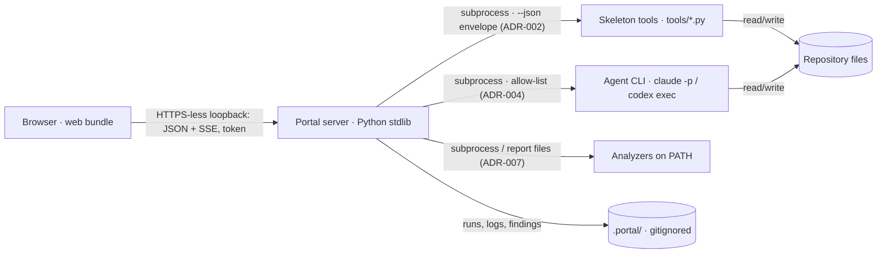

# Architecture

## 1. Context
Local web application, one instance per repository: a Python stdlib HTTP server on `127.0.0.1` serving a prebuilt React/TypeScript bundle to the user's browser (macOS, Windows, Linux; latest 2 versions of Chrome, Edge, Safari, Firefox, Chromium-based). Single user (the developer/owner at the machine). Trust boundary: browser ↔ server (token, Host/Origin checks); server ↔ agent processes (agents never receive the token).

## 2. Building blocks
| Building block | Responsibility | Technology | Package path | Package rules |
|---|---|---|---|---|
| Web app | Screens of the mockup, palette, theme, SSE client, accessible UI | React, React Router, TanStack Query, Vite, TypeScript, CSS tokens, Mermaid | `web/` | `web/AGENTS.md` |
| Portal server | HTTP/JSON API, SSE, auth, static files, run manager, analyzer adapters, contract client | Python ≥ 3.14 stdlib (`http.server`, `subprocess`, `json`) | `server/` | `server/AGENTS.md` |
| Skeleton tools (upstream) | State and writes: `--json` envelope, `gates.py`, `portal.py` launcher, JSON Schemas | Python stdlib | `tools/` (changes go upstream to agentic-skeleton) | AGENTS.md (root) |

Server modules (inside `server/portal_server/`): `http` (routing, auth, SSE), `contract` (tool calls, envelope + version check, cache), `runs` (CLI adapters, queue, scope locks, store), `gates` (via `gates.py`), `insights` (finding model, adapters), `diagrams`, `settings`.

## 3. Data and persistence (outline)
- Project state: repository files only, read and written through the skeleton tools (ADR-002).
- Portal state: `.portal/` (gitignored) — `runs/<id>.json` (meta: step, IDs, tier, model, CLI, scope, status, times, triggered by), `runs/<id>.log` (redacted output, SSE replay), `findings.json`, `<version>/` bundle (ADR-003, ADR-008).
- Browser: theme and UI preferences in `localStorage`; token in `sessionStorage`.

## 4. Integrations and interfaces
| External system / device / host | Direction | Protocol / API / format | Port / adapter | Owner | Phase |
|---|---|---|---|---|---|
| Skeleton tools | in/out | subprocess, JSON envelope `contract: 1.x`, JSON Schemas | `contract` | agentic-skeleton (upstream) | R1 |
| Agent CLIs (`claude -p`, `codex exec`) | out | subprocess, stdout/stderr stream, exit code | `runs/adapters` | vendor | R1 |
| Analyzers (semgrep, gitleaks, pip-audit, npm audit, radon, coverage files…) | in | subprocess or report file; SARIF/JSON | `insights/adapters` | each tool | R2 |
| git | in | subprocess (`git status`, `git diff`, `git log`) | `runs` scope check, `insights` churn | — | R1 |
| GitHub Releases | in | HTTPS download + SHA-256 | `tools/portal.py` | this repo | R1 |
| Browser | in/out | HTTP JSON + SSE on loopback | `http` | — | R1 |

## 5. Security and privacy
ADR-006: loopback bind, per-session 256-bit token (URL fragment → `sessionStorage` → bearer header), Host/Origin checks, writes only via skeleton commands inside the repo root, allow-listed agent commands, agents never get the token, gate actions need a UI confirm nonce, approvals attributed to `project.toml` owner. Run logs redacted for secrets before storing/streaming. No telemetry; nothing leaves the machine except agent CLI traffic (the CLI's own) and the bundle download.

## 6. Observability
Server log to stderr (requests without tokens, errors); run audit records in `.portal/runs/` (NFR-12); `GET /api/health` returns datetime and status, optionally an error code and message, plus portal, contract (built-for) and skeleton versions; skeleton and contract are "unknown" until `wf.py version --json` is available (AP0101, AP0103; owner decision in `analysis/workshops/WORKSHOP_2026-10-19_AP0101-AP0103-AP0106-AP0108.md`). No external telemetry.

## 7. Build, environments and distribution
- Development: `web/` with Vite dev server proxying `/api` to the Python server; `PORTAL_BUNDLE` points the launcher at the local build.
- Release (CI in this repo): build `web/` → copy `server/` + `web/dist/` into a zip (`portal_server/` at the root) → `manifest.json` (format 1: `manifest`, `version`, `asset`, `size`, `sha256`, `requires_python`) → GitHub Release `v<version>` of this repository with both assets.
- Prerequisite: the server needs Python ≥ 3.14 (`requires_python` in the manifest); the launcher itself runs on the skeleton baseline Python ≥ 3.11 and starts the bundle with a matching interpreter (AP0106).
- Projects: `project.toml [portal] version`; `make portal` (or `python tools/portal.py` on Windows without make) downloads, verifies, caches in `.portal/<version>/`, starts on `127.0.0.1:8765` (else next free) with `--repo <root>`, opens the browser; a portal already running for the repo (`.portal/run.json` + `/api/health`) is reopened (ADR-003; skeleton ≥ 1.1.0).

## 8. Testing strategy
| Layer | Proves | Tool | Command |
|---|---|---|---|
| Server unit/integration | routing, auth, run manager (fake CLI), locks, redaction, adapters on recorded outputs | `unittest` | `python3 -m unittest discover -s server/tests` |
| Contract | portal accepts every tool output against the JSON Schemas; version rules | `unittest` + recorded envelopes | same |
| Web unit/component | screens render states (empty, error, gate), keyboard behavior | Vitest + Testing Library | `npm --prefix web test` |
| Accessibility | WCAG 2.2 AA automated checks per screen, both themes | axe-core in Playwright | `npm --prefix web run e2e` |
| End-to-end | flows of the mockup against a fixture repository and a fake agent CLI | Playwright (Chromium, Firefox, WebKit; mobile viewport 375 px) | same |
| Manual | Windows/macOS/Linux launcher, Edge/Safari real browsers | checklist per release | — |

## 9. Conventions for agents
- Project state is never cached as truth: re-read through the contract; the portal never edits workflow files directly.
- Every new tool output needed by the portal is a contract change upstream (schema + minor version), never a parser of Markdown in the portal.
- No third-party runtime dependency in `server/` (CI check). Web dependencies need a reason in the RUN.
- UI follows `reference/mockup/agentic-portal.html` (tokens, behaviors listed as normative in `reference/product/mockup-reference.md`).
- Agent processes never receive portal credentials; gate code paths are covered by tests that simulate an agent caller.
